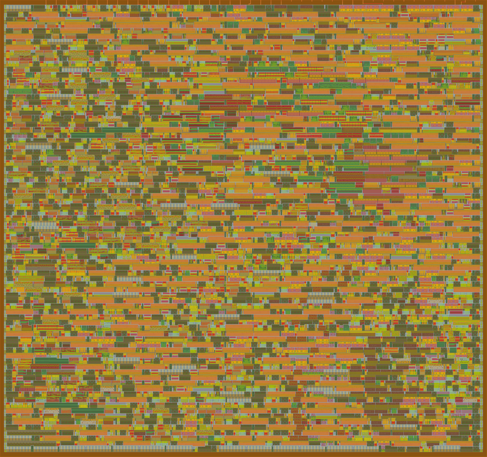

   

# Tiny Tapeout INT8 MAC Engine

A standalone INT8 multiply–accumulate engine with an on-chip post-processing
pipeline (bias → activation → requantize), controlled over a 4-wire SPI
slave. Designed as a co-processor for quantized neural-network inference: a
host MCU streams INT8 operands and bias values in over SPI, issues compute
commands (`MAC`, `CLR_ACC`, `POSTPROC`, `RESET`), and reads back an INT8
result. Storage and tiling are the host's responsibility - this chip is
purely an arithmetic primitive.

The arithmetic core (`conv_pe`, `bias_add`, `activation`, `quantize`,
`postproc`) is lifted unchanged from the
[`lg-npu`](https://github.com/Arty3/lg-npu/) project. The Tiny Tapeout
wrapper adds the SPI slave, a register file, and a command FSM.

- **Top module:** `tt_um_arty3_mac_engine`
- **Tile footprint:** 1x2 (GF180MCU)
- **Target system clock:** 19.23 MHz (52 ns; max ~50 MHz; SPI SCLK ≤ sysclk/4)
- **Data type:** signed INT8 operands, INT32 internal accumulator, INT8 result

## Documentation

- **[docs/SPEC.md](docs/SPEC.md)** - full specification: SPI protocol,
  register map, command sequencing, FSM, pin assignments, reset, timing,
  and the test matrix. This is the authoritative reference.
- **[docs/info.md](docs/info.md)** - public datasheet for the Tiny Tapeout
  database (how it works, how to test, external hardware).
- **[test/README.md](test/README.md)** - cocotb test instructions.

## GDS Render



For a full 3D view click [here](https://arty3.github.io/ttgf-mac-engine/)

## Layout

```
src/    RTL (SystemVerilog + the .v top wrapper)
test/   cocotb testbench
docs/   SPEC.md (authoritative), info.md (tinytapeout datasheet)
assets/ Image assets for markdown files
```

## Tiny Tapeout

- Project page: https://tinytapeout.com
- [FAQ](https://tinytapeout.com/faq/)
- [Digital design lessons](https://tinytapeout.com/digital_design/)
- [Submit a design](https://app.tinytapeout.com/)
