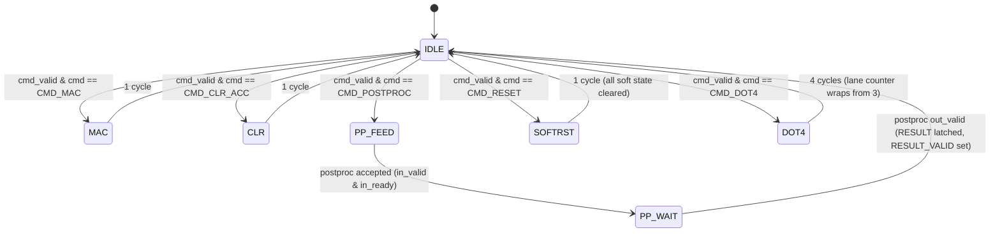
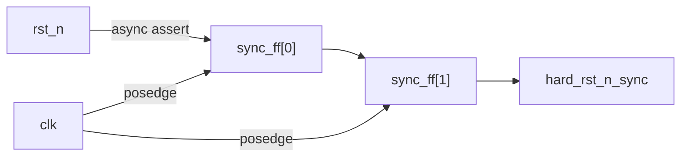

# Tiny Tapeout INT8 MAC Engine - Specification

> Portions of this document (the conv_pe operand contract, the accumulator
> semantics, and the post-processing pipeline including the activation models
> and the quantizer shift behavior) are taken verbatim or lightly adapted from
> the [`lg-npu`](https://github.com/Arty3/lg-npu) project documentation,
> specifically [`docs/arch/overview.md`](../../lg-npu/docs/arch/overview.md)
> and [`docs/arch/compute_dataflow.md`](../../lg-npu/docs/arch/compute_dataflow.md).
> This chip reuses `conv_pe.sv`, `bias_add.sv`, `activation.sv`, `quantize.sv`,
> `postproc.sv`, `pipeline_reg.sv`, and `npu_types_pkg.sv` unchanged from
> that project.

---

## 1. The Chip As A Product

Tiny Tapeout INT8 MAC Engine is a standalone INT8 multiply-accumulate engine with
an on-chip INT8 post-processing pipeline (bias → activation → requantize),
controlled over a 4-wire SPI slave interface. It is intended to be used as a
co-processor for a quantized neural-network inference system: a host MCU
streams operands and bias values in over SPI, issues compute commands, and
reads back INT8 results. Weight/activation storage and tiling are the host's
responsibility - this chip is purely an arithmetic primitive.

| Aspect | Decision |
|--------|----------|
| Data type | INT8 (signed, two's complement) for operands, bias, and result. INT32 internal accumulator. |
| Compute | One INT8xINT8 → INT32 MAC per `MAC` command. Accumulator persists across MAC commands until cleared. |
| Post-processing | Single shared pipeline: `bias_add` → `activation` (None / ReLU / Leaky ReLU, α = 1/8) → `quantize` (arithmetic right-shift + signed saturation). |
| Host interface | SPI slave, mode 0, MSB-first, 8-bit framed. |
| Storage | None. No SRAM, no buffers, no DMA. Operands and results live in regfile bytes only. |
| Platform | Tiny Tapeout GF180MCU shuttle (wafer.space / GF26a). |
| Top module | `tt_um_arty3_mac_engine` |
| Tile footprint | 1x2 (≈ 340 x 320 µm, ≈ 108 800 µm², budget ≈ 3 500–4 000 gates). |
| Target system clock | 25 MHz (40 ns, per `info.yaml`). Max ≈ 50 MHz for reliability; SPI SCLK ≤ sysclk/4. |

Out of scope, explicitly: GEMM, convolution, softmax, layer normalisation,
pooling, DMA, IRQ output, multi-PE arrays, multi-byte SPI burst transfers,
and any data type other than INT8/INT32.

---

## 2. Reused Compute Primitives

The arithmetic core is lifted from `lg-npu` and not redesigned.

### 2.1 The MAC (`conv_pe`)

A single processing element performs:

```
acc_out = acc_in + (act_in * wt_in)    // INT8 x INT8 → INT32 accumulate
```

INT8 operand contract:

| Port    | Width | Encoding                     |
|---------|-------|------------------------------|
| `act_in`| 8     | Signed two's complement (INT8) |
| `wt_in` | 8     | Signed two's complement (INT8) |
| `acc_in`| 32    | Signed two's complement (INT32) |
| `acc_out`| 32   | Signed two's complement (INT32) |

The multiply is `INT8 x INT8 → INT16`, sign-extended to INT32 before being
added to `acc_in`. The result is registered inside the PE with a standard
`valid/ready` handshake. Overflow of the INT32 accumulator wraps in two's
complement and additionally sets `STATUS.ACC_OVF_STK` (see §4.1). It remains
the host's responsibility to keep magnitudes below `2³¹`.

### 2.2 Accumulator Semantics

There is exactly one INT32 accumulator on this chip. It is a single register
inside `conv_pe`'s output stage, surfaced to the regfile as four read-only
bytes (`ACC_B0..ACC_B3`, little-endian).

- On reset (`rst_n` low or `CMD_RESET`), the accumulator is `0`.
- A `CMD_MAC` operation reads `OP_A` and `OP_B` from the regfile and
  computes `acc ← acc + (OP_A * OP_B)`.
- A `CMD_CLR_ACC` operation forces `acc ← 0` without touching `OP_A`/`OP_B`.
- A `CMD_POSTPROC` operation does **not** modify the accumulator; it only
  drives a copy of the accumulator into the post-processing pipeline.

The accumulator persists across MAC commands so that a host can compute a
dot-product of arbitrary length by streaming pairs. This persistence relies
on a specific use of the PE handshake: `conv_pe.ready_out = ~valid_r |
ready_in`, so after the first MAC `valid_r` is stuck at 1 and `ready_out`
collapses to `ready_in`. `cmd_fsm` therefore asserts `valid_in = 1` **and**
`ready_in = 1` simultaneously during the `MAC` state, which forces
`do_accept = 1` regardless of `valid_r` and lets `result_r` be overwritten
with the new accumulated value in a single cycle. See §6.1.

`CMD_CLR_ACC` uses the same trick to zero the accumulator without modifying
`conv_pe.sv` (which has no synchronous clear input): `cmd_fsm` overrides the
PE operand inputs to `act_in = 0`, `wt_in = 0`, `acc_in = 0` for one cycle
while driving `valid_in = 1` and `ready_in = 1`, so `product = 0` is
captured into `result_r`. The regfile-visible `OP_A` and `OP_B` are not
disturbed.

### 2.3 Post-Processing Pipeline (`postproc`)

The `postproc` module chains three single-cycle pipeline stages:

1. **bias_add** - adds the sign-extended INT8 `BIAS` register value to the
   INT32 accumulator copy.
2. **activation** - selectable by the `ACT_MODE` field (2 bits):
   - `ACT_NONE` (`2'b00`) - passthrough.
   - `ACT_RELU` (`2'b01`) - `max(0, x)`.
   - `ACT_LEAKY_RELU` (`2'b10`) - `x ≥ 0 ? x : x >>> 3` (slope α = 1/8).
3. **quantize** - `shifted = x >>> QUANT_SHIFT` (arithmetic right shift,
   `QUANT_SHIFT ∈ [0, 31]`), then signed-saturate to `[−128, +127]`, then
   truncate to INT8.

Each stage is a single `pipeline_reg` on the valid/ready stream. Total
postproc latency is 3 cycles from the cycle the input is accepted to the
cycle the INT8 output is presented. The output byte is latched into the
read-only `RESULT` register.

---

## 3. SPI Protocol

### 3.1 Electrical / Mode

| Property        | Value                                        |
|-----------------|----------------------------------------------|
| Role            | Slave only                                   |
| Wires           | 4 (CS_N, SCLK, MOSI, MISO)                   |
| SPI mode        | Mode 0 - CPOL = 0, CPHA = 0                  |
| Data ordering   | MSB first                                    |
| Frame size      | 8-bit bytes; transactions are 2 bytes        |
| Byte ordering   | Multi-byte registers (accumulator) little-endian over the wire (LSB at lower address) |
| Max SCLK        | ≤ `f_sys / 4` (≤ 6.25 MHz at 25 MHz sysclk) |
| CS_N            | Active low. Must frame each 2-byte transaction. Mid-transaction de-assertion aborts the transaction and the partial bits are discarded. |
| Idle SCLK level | 0                                            |
| Sampling edge   | Rising edge of SCLK (MOSI sampled, MISO updated on falling edge). |
| MISO drive      | Driven actively at all times. Held at `0` while `CS_N = 1`. The pad is **not** tri-stated (see §7.3). |

### 3.2 Frame Format

Every transaction is exactly **two bytes** long, framed by CS_N falling and
rising:

```
Byte 0 (host → chip):  HEADER
  bit 7   : R/W#  (1 = write, 0 = read)
  bits 6:0: 7-bit register address (0x00 .. 0x7F)

Byte 1 (host → chip on write; chip → host on read): DATA
  Write: data to store in the register at HEADER[6:0]
  Read : MOSI bits ignored; chip drives MISO with the current value
         of the register at HEADER[6:0]
```

On a **read** the host MUST still clock 8 SCLK cycles for byte 1; the value
of MOSI during byte 1 is don't-care. MISO during byte 0 is undefined and
should be ignored (the chip has not yet decoded the address). MISO is
driven to `0` whenever `CS_N` is high.

There is no burst mode. Each register access is its own 2-byte transaction.
Back-to-back transactions require CS_N to be raised between them for at
least one SCLK period.

### 3.3 Write/Read Distinction

- A header with bit 7 = 1 is a write. Data takes effect on the rising edge
  of CS_N (the entire 16 bits must complete cleanly). Only synchronised CS_N
  rising edges (after the 2-flop SPI synchroniser in §9.1) trigger the
  write commit. Single-cycle glitches on the `uio[0]` pad are filtered out
  by the synchroniser and are not visible to the regfile.
- A header with bit 7 = 0 is a read. The chip latches the snapshot of the
  addressed register on the **falling edge of the 8th SCLK of byte 0** —
  i.e. the edge immediately after the LSB of the address (header bit 0) is
  sampled. That snapshot is then shifted out MSB-first on MISO during the
  8 SCLK cycles of byte 1. A subsequent read of the same address taken in a
  later transaction re-snapshots.

---

## 4. Register Map

All registers are 8-bit. The 7-bit address space is sparsely populated;
unmapped addresses read as `0x00` and ignore writes.

| Addr  | Name        | R/W | Reset | Description |
|-------|-------------|-----|-------|-------------|
| 0x00  | `STATUS`    | RO  | 0x01  | Status flags. |
| 0x01  | `CMD`       | WO  | -     | Command register. Write-1 launches a command. Reads as 0x00. |
| 0x02  | `OP_A`      | RW  | 0x00  | INT8 multiplicand A (the `act_in` operand). |
| 0x03  | `OP_B`      | RW  | 0x00  | INT8 multiplicand B (the `wt_in` operand). |
| 0x04  | `BIAS`      | RW  | 0x00  | INT8 bias for `bias_add`. |
| 0x05  | `QUANT_SHIFT` | RW | 0x00 | Quantizer right-shift amount. Low 5 bits used; high 3 reserved (read 0). |
| 0x06  | `ACT_MODE`  | RW  | 0x00  | Activation selector. `00`=NONE, `01`=RELU, `10`=LEAKY. Other values treated as NONE. |
| 0x08  | `ACC_B0`    | RO  | 0x00  | Accumulator bits  7:0  (LSB). |
| 0x09  | `ACC_B1`    | RO  | 0x00  | Accumulator bits 15:8. |
| 0x0A  | `ACC_B2`    | RO  | 0x00  | Accumulator bits 23:16. |
| 0x0B  | `ACC_B3`    | RO  | 0x00  | Accumulator bits 31:24 (MSB, sign). |
| 0x0C  | `RESULT`    | RO  | 0x00  | INT8 output of the last `CMD_POSTPROC`. |
| 0x10  | `FEATURE_ID`| RO  | 0xA1  | Hardware ID. Bits 7:4 = `0xA` (engine family), bits 3:0 = `0x1` (rev 1). |
| 0x12  | `OP_A1`     | RW  | 0x00  | INT8 lane-1 multiplicand A for `CMD_DOT4`. |
| 0x13  | `OP_B1`     | RW  | 0x00  | INT8 lane-1 multiplicand B for `CMD_DOT4`. |
| 0x14  | `OP_A2`     | RW  | 0x00  | INT8 lane-2 multiplicand A for `CMD_DOT4`. |
| 0x15  | `OP_B2`     | RW  | 0x00  | INT8 lane-2 multiplicand B for `CMD_DOT4`. |
| 0x16  | `OP_A3`     | RW  | 0x00  | INT8 lane-3 multiplicand A for `CMD_DOT4`. |
| 0x17  | `OP_B3`     | RW  | 0x00  | INT8 lane-3 multiplicand B for `CMD_DOT4`. |

### 4.1 `STATUS` (0x00)

| Bit | Name           | Description |
|-----|----------------|-------------|
| 0   | `IDLE`         | 1 when the `cmd_fsm` is in IDLE and the postproc pipe is empty. |
| 1   | `BUSY`         | 1 when a command is executing (mutually exclusive with IDLE). |
| 2   | `RESULT_VALID` | Set on completion of `CMD_POSTPROC`. Cleared by reading `RESULT`. |
| 3   | `ACC_OVF_STK`  | Sticky flag set if any MAC produced an INT32 overflow. Cleared by `CMD_RESET` or hard reset; no software clear via direct register write. |
| 7:4 | -              | Reserved, read as 0. |

### 4.2 `CMD` (0x01)

Writes a command code. The value is captured by `cmd_fsm` and self-clears
once accepted. A `CMD` write is dropped iff `cmd_fsm.state ≠ IDLE` on the
cycle the regfile latches the write (the synchronised CS_N rising edge of
the `CMD` transaction). A same-cycle return to `IDLE` counts as `IDLE` —
the write is accepted, because the next-state logic that lowers `state` is
the same combinational cycle that the new command is observed.

| Code | Mnemonic        | Action |
|------|-----------------|--------|
| 0x00 | `CMD_NOP`       | No operation. |
| 0x01 | `CMD_MAC`       | `acc ← acc + OP_A * OP_B`. Single cycle of compute, plus regfile latency. |
| 0x02 | `CMD_CLR_ACC`   | `acc ← 0`. Does not touch `OP_A`/`OP_B`/`BIAS`/etc. |
| 0x03 | `CMD_POSTPROC`  | Drive a snapshot of `acc` through `bias_add → activation → quantize`. Result latched into `RESULT`, `STATUS.RESULT_VALID` set. |
| 0x04 | `CMD_DOT4`      | 4-cycle burst MAC: `acc ← acc + Σ OP_A{i} * OP_B{i}` for i = 0..3, where lane 0 reuses `OP_A`/`OP_B` and lanes 1..3 use `OP_A1..3`/`OP_B1..3`. Halves SPI overhead per output vs. four `CMD_MAC` issues. Per-lane overflow is folded into `STATUS.ACC_OVF_STK`. |
| 0xFF | `CMD_RESET`     | Soft reset. Equivalent to one cycle of `rst_n` low. Clears `acc`, `RESULT`, all sticky flags; preserves `OP_A`/`OP_B`/`BIAS`/`QUANT_SHIFT`/`ACT_MODE`. |

All other codes are treated as `CMD_NOP`.

---

## 5. Command Sequencing

Each step below is one complete CS_N-framed 2-byte SPI transaction. `MOSI`
bytes are shown; the host clocks 16 SCLK cycles per step.

### 5.1 "Do a MAC" (single multiply-accumulate)

Pre-condition: host has chosen `OP_A` and `OP_B`.

| Step | MOSI bytes | Meaning |
|------|-----------|---------|
| 1 | `0x82  0xAA` | Write `OP_A` (addr 0x02) ← `0xAA`. |
| 2 | `0x83  0xBB` | Write `OP_B` (addr 0x03) ← `0xBB`. |
| 3 | `0x81  0x01` | Write `CMD` (addr 0x01) ← `CMD_MAC`. |
| 4 | `0x00  0x00` | Read `STATUS`. Repeat until MISO byte 1 has bit 0 (`IDLE`) = 1. |

Latency from step 3 *synchronised* CS_N rise to `IDLE` re-assertion: 2
system clocks (1 cycle in `MAC` state writing the PE, 1 cycle for the
state register to return to `IDLE`). Add the CS_N synchroniser + edge-detect
latency (3 sysclks total — 2 for the 2-flop synchroniser, 1 for the rising-
edge detector that compares `cs_n_sync` against its one-cycle delay; see
§9.1) to get the worst-case wall-clock latency from the physical CS_N pad
rising edge: 5 sysclks (200 ns at 25 MHz).

### 5.2 "Reset the accumulator"

| Step | MOSI bytes | Meaning |
|------|-----------|---------|
| 1 | `0x81  0x02` | Write `CMD` ← `CMD_CLR_ACC`. |
| 2 | `0x00  0x00` | Read `STATUS`; poll for `IDLE = 1` (1 sysclk). |

### 5.3 "Do postproc"

Pre-condition: `BIAS`, `QUANT_SHIFT`, `ACT_MODE` are set and the
accumulator holds the value the host wants to quantize.

| Step | MOSI bytes | Meaning |
|------|-----------|---------|
| 1 | `0x84  <bias>`        | Write `BIAS`. |
| 2 | `0x85  <shift>`       | Write `QUANT_SHIFT` (0..31). |
| 3 | `0x86  <act_mode>`    | Write `ACT_MODE` (0..2). |
| 4 | `0x81  0x03`          | Write `CMD` ← `CMD_POSTPROC`. |
| 5 | `0x00  0x00`          | Read `STATUS`; poll until `RESULT_VALID = 1` (≈ 4 sysclks: 1 launch + 3 pipeline stages). |

### 5.4 "Read the result"

| Step | MOSI bytes | MISO (byte 1) |
|------|-----------|---------------|
| 1 | `0x0C  0x00` | INT8 contents of `RESULT`. Reading clears `STATUS.RESULT_VALID`. |

To read the raw INT32 accumulator instead, four reads at addresses `0x08`,
`0x09`, `0x0A`, `0x0B` give bits `[7:0]`, `[15:8]`, `[23:16]`, `[31:24]`
respectively. To guarantee coherence in the presence of concurrent
`CMD_MAC` traffic, the regfile maintains a 32-bit **accumulator shadow
register**: reading `ACC_B0` (addr `0x08`) atomically copies the current
`conv_pe.result_r` into the shadow on the same cycle the read-snapshot is
taken (§3.3). Subsequent reads of `ACC_B1`, `ACC_B2`, `ACC_B3` return
bytes from the shadow, not from the live accumulator. The shadow is
re-loaded on every read of `ACC_B0`. The host must therefore always read
the four bytes in the order `0x08, 0x09, 0x0A, 0x0B` to obtain a coherent
INT32; reading them out of order, or skipping `ACC_B0`, returns whatever
the shadow held from the previous `ACC_B0` read.

#### Read-side effects

Two registers have side effects when read. Both fire on the read-snapshot
edge defined in §3.3 (falling edge of the 8th SCLK of byte 0):

| Read of | Side effect |
|---------|-------------|
| `RESULT` (0x0C) | Clears `STATUS.RESULT_VALID` to 0. |
| `ACC_B0` (0x08) | Copies the current `conv_pe.result_r` into the 32-bit accumulator shadow register. `ACC_B1..3` then read out of this shadow. |

Reads of `ACC_B1`, `ACC_B2`, `ACC_B3`, `STATUS`, and every other register
have no side effects.

#### Same-cycle race: ACC_B0 read vs CMD_MAC

If the regfile's `ACC_B0` read-snapshot edge and `cmd_fsm`'s end-of-`MAC`
write to `conv_pe.result_r` land on the same `clk` edge, the shadow load
samples the **pre-MAC** value of `result_r`. The shadow tap is taken from
the PE output before the MAC writeback in the same cycle; the regfile
snapshot wins the race. In practice a single-master SPI host serialises
its own traffic and the situation does not arise — software should poll
`STATUS.IDLE = 1` between a MAC and the ACC read — but the behaviour is
defined.

### 5.5 Worked example: dot product of `[3, -2]` and `[4, 5]`, ReLU, shift 0

```
1. 0x81 0x02   ; CMD_CLR_ACC
2. 0x82 0x03   ; OP_A = 3
3. 0x83 0x04   ; OP_B = 4
4. 0x81 0x01   ; CMD_MAC          acc = 12
5. 0x82 0xFE   ; OP_A = -2
6. 0x83 0x05   ; OP_B = 5
7. 0x81 0x01   ; CMD_MAC          acc = 12 + (-10) = 2
8. 0x84 0x00   ; BIAS = 0
9. 0x85 0x00   ; QUANT_SHIFT = 0
10.0x86 0x01   ; ACT_MODE = RELU
11.0x81 0x03   ; CMD_POSTPROC
12.0x0C 0x00   ; read RESULT -> 0x02
```

---

## 6. `cmd_fsm` State Machine

`cmd_fsm` is the only sequencer on the chip. It owns the handshake to
`conv_pe` and `postproc`, and it owns the shadow copy of the accumulator
used for ACC reads (§5.4) and the `RESULT` write. The regfile owns
everything else.

The `state` register is 3 bits wide and encodes 7 reachable states
(`IDLE`, `MAC`, `CLR`, `PP_FEED`, `PP_WAIT`, `SOFTRST`, `DOT4`). Code
`3'b111` is reserved and unreachable in normal operation. If it is
observed on `uo_out[4:6]` during post-silicon bring-up, the chip has
suffered an SEU or some other physical fault — normal `cmd_fsm`
next-state logic cannot produce that encoding.

State transitions are **registered**: `next_state` is combinational on
`cmd_valid` and the current `state`, and the state register updates on
the next rising edge of `clk`. `cmd_valid` itself is a 1-cycle pulse the
regfile raises on the synchronised CS_N rising edge of a successful `CMD`
write. This locks the latencies quoted in §5 and the boundary case in
§4.2.



### 6.1 What each state does

| State    | Regfile interaction | Compute interaction |
|----------|---------------------|---------------------|
| `IDLE`   | Drives `STATUS.IDLE = 1`, `STATUS.BUSY = 0`. Watches for a `cmd_valid` pulse from the regfile (raised when the host writes `CMD`). | Holds `conv_pe.valid_in = 0`, `conv_pe.ready_in = 0`, `postproc.in_valid = 0`. |
| `MAC`    | Reads `OP_A`, `OP_B` combinationally. | Drives `act_in = OP_A`, `wt_in = OP_B`, `acc_in = conv_pe.acc_out` (the current `result_r` looped back), and asserts `valid_in = 1` **and** `ready_in = 1` simultaneously. This forces `do_accept = (valid_in & ready_out) = 1` regardless of the PE's `valid_r` state (`ready_out = ~valid_r \| ready_in = 1` because `ready_in = 1`), so `result_r` is overwritten with the new accumulated value in a single cycle. `ACC_OVF_STK` is OR-ed with the overflow detect derived from the sign bits of `acc_in`, `product`, and the new `result_r`. |
| `CLR`    | - | The PE has no synchronous clear input. `cmd_fsm` instead overrides the PE operand muxes to inject zeros: `act_in = 0`, `wt_in = 0`, `acc_in = 0`, with `valid_in = 1` and `ready_in = 1`. The PE computes `product = 0` and captures it into `result_r`, zeroing the accumulator in one cycle. `OP_A` and `OP_B` in the regfile are untouched. |
| `PP_FEED`| Reads `BIAS`, `QUANT_SHIFT`, `ACT_MODE` as static inputs to `postproc`. | Drives `postproc.in_data = conv_pe.acc_out`, `in_valid = 1`. Waits for `in_ready`. |
| `PP_WAIT`| - | Holds `in_valid = 0`. Waits for `postproc.out_valid`. When it fires, captures `postproc.out_data` into `RESULT`, sets `STATUS.RESULT_VALID`. |
| `SOFTRST`| Pulses an internal reset that re-applies the reset values listed in §4 to: `acc`, `RESULT`, `STATUS.RESULT_VALID`, `STATUS.ACC_OVF_STK`. | Re-initialises `conv_pe.result_r` and the three `postproc` pipeline registers. |
| `DOT4`   | Reads `OP_A`/`OP_B` and `OP_A{1..3}`/`OP_B{1..3}` combinationally; an internal 2-bit lane counter selects one pair per cycle. | Behaves like `MAC` for four consecutive cycles, accumulating each `OP_A{i} * OP_B{i}` into `result_r`. Per-cycle overflow is OR-ed into `ACC_OVF_STK`. Exits to `IDLE` on the cycle where the lane counter reaches 3. |

`STATUS.BUSY` is `(state != IDLE)`. The accept/drop rule for a `CMD` write
that arrives near a state transition is defined in §4.2.

---

## 7. Pin Assignments

All pin directions are fixed at synthesis time. `uio_oe` is a constant
vector - there is no tri-state dance on the bidirectional pads beyond
MISO.

### 7.1 Dedicated inputs (`ui_in[7:0]`)

Currently unused. Reserved for future use as a parallel debug input or as
an auxiliary clock (see §9). To prevent LibreLane from flagging floating
inputs and to silence Verilator `UNUSED` warnings, the top module includes:

```systemverilog
wire _unused_ui_in = &{ui_in, 1'b0};
```

This AND-reduces all 8 bits into a single unused 1-bit net, satisfying
the lint/EDA toolchain without changing the synthesised pin behaviour.

| Pin       | Function           |
|-----------|--------------------|
| `ui_in[0]`| reserved (aux_clk_in candidate) |
| `ui_in[1..7]` | reserved        |

### 7.2 Dedicated outputs (`uo_out[7:0]`)

Status mirror for board-level LEDs / logic-analyser bring-up. These are
direct copies of internal signals and have no software side-effects.

| Pin        | Function |
|------------|----------|
| `uo_out[0]`| `STATUS.IDLE` |
| `uo_out[1]`| `STATUS.BUSY` |
| `uo_out[2]`| `STATUS.RESULT_VALID` |
| `uo_out[3]`| `STATUS.ACC_OVF_STK` |
| `uo_out[4]`| `cmd_fsm` state bit 0 |
| `uo_out[5]`| `cmd_fsm` state bit 1 |
| `uo_out[6]`| `cmd_fsm` state bit 2 |
| `uo_out[7]`| heartbeat - system clock divided by 2²⁰ |

### 7.3 Bidirectional pins (`uio[7:0]`)

The SPI slave lives entirely on `uio`. `uio_oe` is hard-wired to
`8'b0000_1000` - only MISO is driven; everything else is an input.

| Pin     | Direction | Function  |
|---------|-----------|-----------|
| `uio[0]`| in        | `SPI_CS_N`  (active low chip select) |
| `uio[1]`| in        | `SPI_SCLK`  (mode 0) |
| `uio[2]`| in        | `SPI_MOSI`  |
| `uio[3]`| out       | `SPI_MISO`  (driven actively at all times; held at `1'b0` while `CS_N` is high) |
| `uio[4]`| in        | reserved (read 0) |
| `uio[5]`| in        | reserved |
| `uio[6]`| in        | reserved |
| `uio[7]`| in        | reserved |

> Note on MISO: the Tiny Tapeout `uio_oe` vector is a per-pin constant
> set at the top level. `uio_oe[3]` is hard-wired to `1`, so MISO is a
> permanent output — it is **not** tri-stated when `CS_N` is high. The
> internal MISO data driver is forced to `1'b0` whenever `CS_N = 1` so
> the line is at a defined logic level. If this chip is placed on a
> shared SPI bus with other slaves, the user must add an external
> CS_N-gated buffer; the chip does not provide bus-hand-off on its own.

### 7.4 Power / control pins (fixed by TT)

| Pin   | Direction | Function |
|-------|-----------|----------|
| `clk` | in        | System clock, 25 MHz nominal. |
| `rst_n` | in      | Asynchronous active-low reset (synchronised internally). |
| `ena` | in        | Always 1 when the project is selected. Ignored. |

---

## 8. Reset Behavior

The chip has two reset sources, combined with a logical OR (mirrors the
lg-npu `npu_reset_ctrl` pattern):

| Source     | Trigger                          | Duration |
|------------|----------------------------------|----------|
| Hard reset | External `rst_n` low             | Until `rst_n` high |
| Soft reset | Host writes `CMD ← 0xFF` (CMD_RESET) | 1 cycle, self-clearing |

### 8.1 Synchroniser

External `rst_n` passes through a 2-flop async-assert / sync-deassert
synchroniser on the system clock domain (identical pattern to lg-npu):



- **Assert**: when `rst_n` falls, both flops are immediately forced low.
- **Deassert**: when `rst_n` rises, the `1` propagates on two successive
  rising edges of `clk`, ensuring glitch-free release.

### 8.2 Reset State

When `rst_n` is low (or `CMD_RESET` is fired), every flop in the design is
forced to a known value:

| Domain | Element | Reset value |
|--------|---------|-------------|
| `conv_pe` | `result_r` (accumulator) | `32'h0000_0000` |
| `conv_pe` | `valid_r`                | `1'b0` |
| `postproc` | All 3 `pipeline_reg.valid` flops | `1'b0` |
| `regfile` | `OP_A`, `OP_B`, `BIAS`, `QUANT_SHIFT`, `ACT_MODE` | `0x00` (hard reset only - `CMD_RESET` preserves these) |
| `regfile` | `RESULT` | `0x00` |
| `regfile` | `STATUS.RESULT_VALID`, `STATUS.ACC_OVF_STK` | `0` |
| `regfile` | 32-bit accumulator shadow (§5.4) | `32'h0000_0000` (cleared by both hard reset and `CMD_RESET`, in sync with the PE accumulator) |
| `cmd_fsm` | `state`  | `IDLE` |
| `spi_slave` | bit counter, shift register, byte counter | `0` |

`STATUS` after reset reads `0x01` (`IDLE=1`, everything else 0).

### 8.3 Reset-to-SPI-ready Latency

The SPI slave's shift register and CS_N edge detector are clocked by the
system clock. After `rst_n` rises, the slave is ready to accept SPI
traffic on:

- **+2 sysclks** for the async-deassert synchroniser to release the design.
- **+1 sysclk** for the CS_N rising-edge detector to clear and arm.

→ Total: **3 system clock cycles** after `rst_n` rise. At 25 MHz this is
120 ns. The host MUST hold `CS_N = 1` for at least this long after
asserting `rst_n` and releasing it. Equivalently: the first SPI
transaction after `rst_n` release must begin (CS_N falling edge) no
earlier than 3 sysclks (120 ns at 25 MHz) after the rising edge of
`rst_n` at the chip pad.

`CMD_RESET` (soft reset) has the same internal latency but does not affect
the SPI slave (the regfile keeps running through the reset pulse so the
write that issued `CMD_RESET` completes cleanly).

---

## 9. Clock Domains

The chip nominally has **one** clock domain: the system clock `clk` (25 MHz
target, ≤ 50 MHz reliable per the GF180MCU TT pad characteristics). All
flops in `conv_pe`, `postproc`, `regfile`, and `cmd_fsm` are clocked by
`clk`.

The SPI interface introduces a **second pseudo-domain** through SCLK and
CS_N. The chip does **not** clock any flop on SCLK directly - instead,
SCLK and CS_N are oversampled by `clk` and edge-detected. This is the
correct approach for the GF180MCU TT environment because:

- The system clock comes from the RP2040 (1 Hz – 66.5 MHz) and is stable.
- The SPI master is the host MCU and is asynchronous to `clk`.
- Designing flops on SCLK would create a tiny clock domain that LibreLane
  must time-close separately, which is not worth the area at the SCLK
  rates required (≤ 6.25 MHz).

### 9.1 Synchronisers

Three 2-flop synchronisers, all clocked by `clk`, are placed at the SPI
pad inputs inside `spi_slave`:

```
SPI_SCLK  ── pad ── [FF1] ── [FF2] ── sclk_sync   ─┐
SPI_CS_N  ── pad ── [FF1] ── [FF2] ── cs_n_sync   ─┼─ edge-detect & shift
SPI_MOSI  ── pad ── [FF1] ── [FF2] ── mosi_sync   ─┘
```

Rising and falling edges of `sclk_sync` are detected by comparison with a
one-cycle-delayed copy. The MOSI sample on the rising edge feeds the
8-bit shift register. The falling edge of `sclk_sync` clocks out the next
MISO bit (kept in the system clock domain - there is no SCLK-domain
flop).

### 9.2 Required Frequency Relationship

To guarantee that every SCLK edge is captured by the rising-edge detector,
SCLK must be slow enough that two `clk` edges fall inside each SCLK half-period.
This requires:

```
f_SCLK ≤ f_sys / 4
```

At the nominal 25 MHz sysclk this caps SCLK at 6.25 MHz; at the 50 MHz
practical max this caps SCLK at 12.5 MHz. The chip will not function
correctly above this ratio.

### 9.3 Auxiliary Clock

Tiny Tapeout allows one `ui_in` pin to be used as an auxiliary clock. This
chip does **not** use that feature in the v1 hardening - `ui_in[0]` is
reserved for it in case a future revision wants to drive SPI from a
faster auxiliary clock domain.

---

## 10. Bringup Test Plan (post-silicon, GF26a return)

When the physical chip arrives, the following tests will be run in order on
the TT demo board (RP2040 host driving SPI via PIO, 1 MHz SCLK initially).
Each test is a strict pre-condition for the next.

### 10.1 Static / DC

| # | Name | Procedure | Pass criterion |
|---|------|-----------|----------------|
| T1 | Power-on | Apply VDD, observe `ena` from the TT mux. | No excess current. `uo_out[7]` heartbeat toggling once clk is applied. |
| T2 | Reset toggle | Strobe `rst_n` low for 1 µs, release. | `uo_out[0]` (`IDLE`) goes high within 200 ns of `rst_n` release. |

### 10.2 SPI link

| # | Name | Procedure | Pass criterion |
|---|------|-----------|----------------|
| T3 | FEATURE_ID read | Issue `{0x10, 0x00}` SPI read. | MISO byte 1 = `0xA1`. |
| T4 | Register R/W loopback | Write `OP_A = 0x5A`, read it back. Repeat for `0xA5`, `0x00`, `0xFF`. | Read-back matches each pattern. |
| T5 | Reserved-address sanity | Read addresses `0x07`, `0x0D..0x0F`, `0x11..0x7F`. | All return `0x00`. |

### 10.3 Compute primitives

| # | Name | Procedure | Pass criterion |
|---|------|-----------|----------------|
| T6 | CLR_ACC | `CMD_CLR_ACC`, then read `ACC_B0..3`. | All four bytes are `0x00`. |
| T7 | Positive MAC | `OP_A=7`, `OP_B=6`, `CMD_MAC`, read ACC. | ACC = `0x0000_002A` (= 42). |
| T8 | Negative MAC + accumulate | Continuing from T7: `OP_A=-1`, `OP_B=2`, `CMD_MAC`. | ACC = `0x0000_0028` (= 40). |
| T9 | Saturation sweep | Repeated `CMD_MAC` with `OP_A=OP_B=127` until `ACC_OVF_STK` sets. | `ACC_OVF_STK` becomes 1 after ≈ `2³¹ / 127²` ≈ 133 000 MACs and stays sticky. |

### 10.4 Post-processing

| # | Name | Procedure | Pass criterion |
|---|------|-----------|----------------|
| T10 | Bias + NONE + shift 0 | Reset, MAC `5*6=30`, `BIAS=2`, `ACT_MODE=NONE`, `QUANT_SHIFT=0`, `CMD_POSTPROC`. | `RESULT = 32`. |
| T11 | ReLU clamp | Reset, MAC `5*-6=-30`, `BIAS=0`, `ACT_MODE=RELU`, `QUANT_SHIFT=0`, `CMD_POSTPROC`. | `RESULT = 0`. |
| T12 | Leaky ReLU | Same as T11 but `ACT_MODE=LEAKY_RELU`. | `RESULT = (-30) >>> 3 = -4` (`0xFC`). |
| T13 | Quantize saturate-high | Construct ACC = `0x0000_4000` (16384) via MACs, `QUANT_SHIFT=4`, `ACT_MODE=NONE`. | `RESULT = +127` (saturation). |
| T14 | Quantize saturate-low | Construct ACC = `0xFFFF_C000` (−16384) via MACs, `QUANT_SHIFT=4`, `ACT_MODE=NONE`. | `RESULT = -128` (saturation). |
| T15 | Quantize round-trip | ACC = 256, `QUANT_SHIFT=2`, `ACT_MODE=NONE`. | `RESULT = 64`. |

### 10.5 Sequencing / interlock

| # | Name | Procedure | Pass criterion |
|---|------|-----------|----------------|
| T16 | Read clears RESULT_VALID | Run T10, observe `STATUS.RESULT_VALID=1`, read `RESULT`, read `STATUS`. | `RESULT_VALID` is now 0. |
| T17 | Soft reset preserves config | Write `OP_A=0x55`, `BIAS=0x33`, run a MAC, then `CMD_RESET`, read ACC and OP_A and BIAS. | ACC = 0, OP_A = 0x55, BIAS = 0x33, ACC_OVF_STK = 0. |
| T18 | CMD during BUSY dropped | Issue `CMD_POSTPROC`, immediately issue `CMD_MAC` before `IDLE` returns. | Second command has no observable effect; ACC unchanged. |

### 10.6 Clock margin

| # | Name | Procedure | Pass criterion |
|---|------|-----------|----------------|
| T19 | Sysclk sweep | Repeat T7 with `clk` swept 1 MHz → 50 MHz in 1 MHz steps, SCLK fixed at 1 MHz. | All pass. |
| T20 | SCLK sweep at 25 MHz sysclk | Repeat T4 with SCLK swept 100 kHz → 6.25 MHz. | All pass. |
| T21 | SCLK over-rate failure mode | Run T4 at SCLK = `f_sys / 3` and `f_sys / 2`. | Documented failure (corruption) - confirms the f_sys/4 constraint. |

### 10.7 Endurance

| # | Name | Procedure | Pass criterion |
|---|------|-----------|----------------|
| T22 | 1 M MAC soak | Loop: random `OP_A`, `OP_B`, `CMD_MAC` for 1 000 000 iterations, compare ACC against a host-side reference each 1 000 iterations. | All checkpoints match. |
| T23 | 1 hr SPI soak | Loop T4 continuously for one hour. | Zero mismatches. |

Tests T1 through T18 are the minimum required to declare the chip
"functional"; T19 through T23 establish operating margins and
go-to-production confidence.
